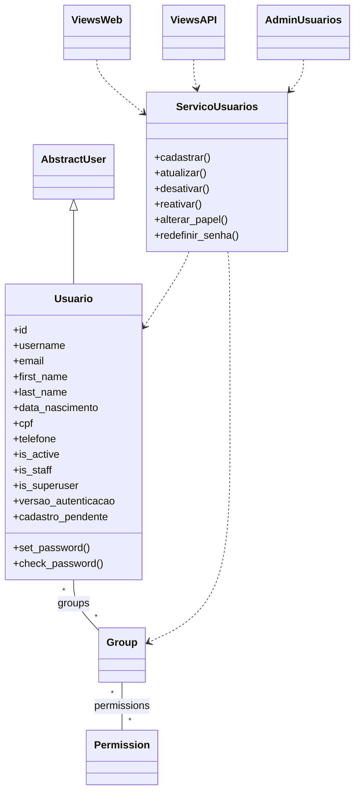
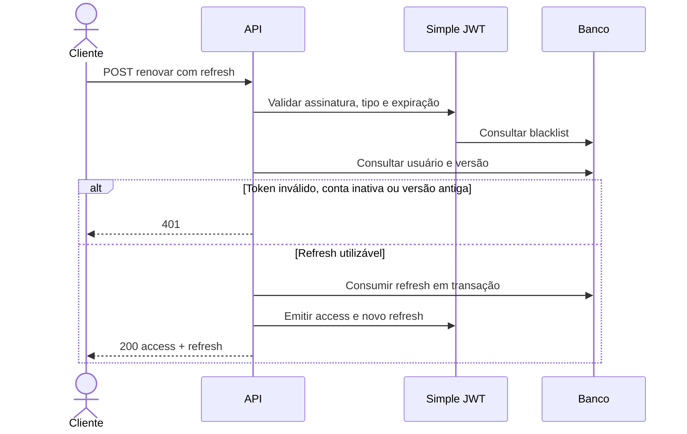
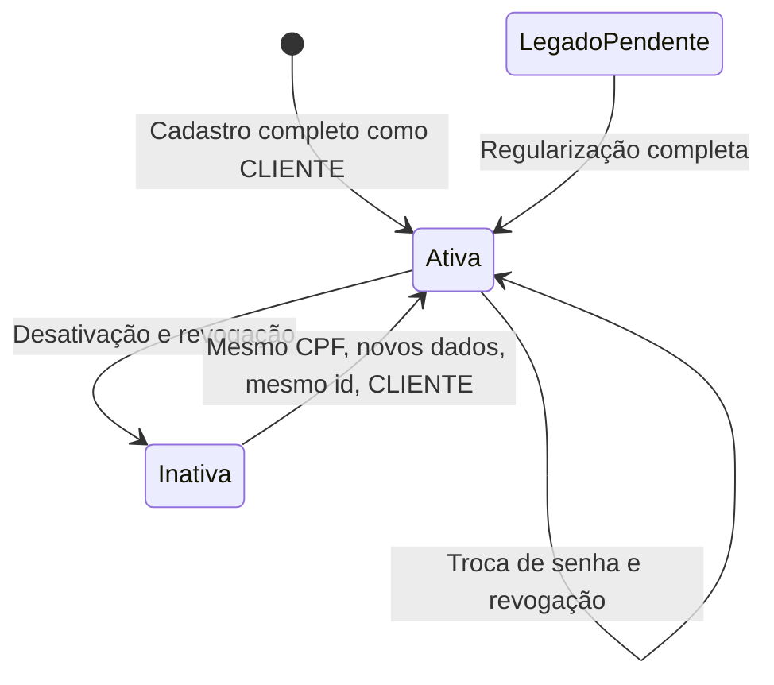

# Plano aprovado — App usuarios

**Projeto:** Germana's Store  
**Status:** aprovado para implementação  
**Data:** 2026-11-06  

> Este documento não deve ser modificado sem autorização explícita do usuário.
> Ajustes necessários durante a implementação devem ser apresentados para aprovação antes de alterar este plano.

## 1. Objetivo e escopo

Adicionar o app `usuarios` ao e-commerce, aproveitando os recursos nativos do Django para cadastro, autenticação, sessões, recuperação de senha, administração e permissões.

A entrega contempla:

- Cadastro público e administrativo.
- Consulta e atualização cadastral.
- Desativação e reativação de contas.
- Papéis ADMIN, VENDEDOR e CLIENTE.
- Login e logout Web.
- Autenticação e renovação de tokens JWT na API.
- Recuperação de senha por email.
- Administração de usuários pela Web, API e Django Admin.
- Adequação da navegação.
- Autenticação obrigatória na API de produtos.
- CRUD de produtos na API.
- Preservação dos dados existentes.
- Testes automatizados e atualização do AGENTS.md.

## 2. Decisões funcionais confirmadas

As seguintes decisões substituem ou esclarecem pontos do pedido inicial:

1. A recuperação de senha envia um **link para escolher uma nova senha**, em vez de enviar uma senha por email.
2. A API utiliza JWT sem sessão, mas consulta o estado atual do usuário em cada acesso e renovação para garantir invalidação imediata.
3. A reativação pública ocorre somente pela identificação de um CPF desativado, sem confirmação do email anterior.
4. A conta reativada conserva seu `id`, recebe os novos dados cadastrais e passa a ser CLIENTE.
5. O CPF é imutável após ser cadastrado.
6. O email é exclusivo, sem distinguir maiúsculas e minúsculas.
7. O username mantém as regras nativas do Django.
8. O banco e os dados existentes devem ser preservados.
9. Usuários legados incompletos devem regularizar o cadastro.
10. A entrega inclui endpoints de escrita de produtos.
11. Falhas de autenticação retornam 401; falta de permissão retorna 403.

**Consequência aceita da reativação:** conhecer o CPF de uma conta desativada será suficiente para assumir essa conta e seu histórico associado ao mesmo `id`.

## 3. Requisitos funcionais e regras de negócio

### RF-01 — Dados cadastrais

O usuário deve possuir:

| Atributo | Comportamento |
|---|---|
| `id` | Identificador positivo, automático e permanente |
| `username` | Login exclusivo, com regras nativas do Django |
| `email` | Email obrigatório e exclusivo, sem distinguir maiúsculas |
| `password` | Senha obrigatória no cadastro e opcional na atualização |
| `data_nascimento` | Data de nascimento de pessoa com pelo menos 18 anos |
| `cpf` | CPF válido e exclusivo |
| `first_name` | Primeiro nome obrigatório |
| `last_name` | Sobrenome obrigatório |
| `telefone` | Telefone brasileiro obrigatório com DDD |

Todos os dados cadastrais são obrigatórios em novos cadastros, inclusive administrativos.

Nomes de atributos e interfaces nativos do Django devem permanecer em inglês. Atributos próprios do projeto devem usar pt-BR.

### RF-02 — Validação e normalização

- Datas devem ser recebidas e representadas em ISO `AAAA-MM-DD`.
- Mensagens de validação devem ser em pt-BR.
- Calcular a idade por calendário, usando a data local de `America/Bahia`.
- Rejeitar nascimento futuro e idade inferior a 18 anos.
- Nascidos em 29/02 completam idade em 01/03 nos anos não bissextos.
- CPF pode ser informado com pontuação, mas deve ser armazenado com 11 dígitos.
- Validar dígitos verificadores do CPF e rejeitar sequências repetidas.
- CPF não pode ser alterado após seu primeiro preenchimento.
- Telefone deve ser armazenado apenas com dígitos.
- Aceitar telefone fixo com 10 dígitos ou celular com 11 dígitos, incluindo DDD válido.
- Aceitar prefixo brasileiro `+55`, removendo-o na normalização.
- Rejeitar ramais e números estrangeiros.
- Telefone não precisa ser exclusivo.
- Username, email e CPF continuam reservados enquanto a conta estiver inativa.
- Não permitir dados obrigatórios vazios em novos cadastros ou em cadastros já regularizados.

### RF-03 — Senhas

- Senhas devem passar pelos validadores do Django.
- Na atualização, a senha pode ser omitida.
- Senha enviada vazia deve ser rejeitada.
- A validação deve considerar os dados finais do usuário, incluindo alterações de nome, username e email.
- Senhas devem ser armazenadas exclusivamente pelos mecanismos de hash do Django.
- Senhas e hashes nunca devem aparecer em respostas, tokens, erros ou telas administrativas.
- Alteração ou redefinição de senha invalida acessos anteriores.
- Após alteração de senha, exigir novo login, inclusive na sessão Web que realizou a alteração.

### RF-04 — Papéis

#### ADMIN

- Possui `is_superuser=True` e `is_staff=True`.
- Acessa o Django Admin.
- Pode consultar, cadastrar, atualizar e desativar qualquer usuário.
- Pode promover e rebaixar usuários.
- Pode reativar contas.
- Possui todos os poderes de superusuário.
- Pode criar, consultar, atualizar e excluir produtos.

#### VENDEDOR

- Pode criar, consultar, atualizar e excluir produtos pela API.
- Pode consultar, atualizar e desativar somente o próprio usuário.
- Não acessa o Django Admin.
- Não pode promover usuários.

#### CLIENTE

- Pode consultar produtos.
- Pode consultar, atualizar e desativar somente o próprio usuário.
- Não acessa o Django Admin.
- Não pode promover usuários.

### RF-05 — Matriz de autorização

| Operação | Visitante | CLIENTE | VENDEDOR | ADMIN |
|---|---:|---:|---:|---:|
| Consultar páginas de produtos | Sim | Sim | Sim | Sim |
| Consultar API de produtos | Não | Sim | Sim | Sim |
| Escrever produtos pela API | Não | Não | Sim | Sim |
| Usar cadastro público | Sim | Sim | Sim | Sim |
| Consultar e editar a própria conta | Não | Sim | Sim | Sim |
| Desativar a própria conta | Não | Sim | Sim | Sim |
| Listar usuários | Não | Não | Não | Sim |
| Administrar outro usuário | Não | Não | Não | Sim |
| Alterar papéis | Não | Não | Não | Sim |
| Acessar Django Admin | Não | Não | Não | Sim |

A proteção do último ADMIN ativo prevalece sobre as permissões administrativas e de autodesativação.

### RF-06 — Cadastro público

- Deve ser possível cadastrar usuário sem autenticação.
- Todo cadastro público resulta em CLIENTE.
- Rejeitar campos privilegiados, sem ignorá-los silenciosamente.
- CPF já associado a conta ativa retorna erro de validação.
- CPF associado a conta inativa aciona a reativação.
- Colisões de username ou email com outra conta retornam erro de validação.
- Cadastro novo retorna HTTP 201.
- Reativação pelo cadastro público retorna HTTP 200.

### RF-07 — Cadastro administrativo e promoção

- ADMIN pode cadastrar usuários.
- O cadastro administrativo também começa como CLIENTE.
- A promoção é uma operação administrativa explícita e separada.
- Somente ADMIN pode atribuir ADMIN ou VENDEDOR.
- Alteração de papel deve produzir efeito imediato na autorização.
- ADMIN implica obrigatoriamente acesso ao Django Admin e poderes de superusuário.

### RF-08 — Consulta e atualização

- CLIENTE e VENDEDOR acessam somente o próprio cadastro.
- ADMIN acessa qualquer cadastro, inclusive inativo.
- A listagem administrativa inclui contas ativas e inativas.
- Ordenar a listagem por `id`, com 12 registros por página.
- Atualização parcial aceita somente os campos informados.
- Atualização completa exige todos os campos cadastrais editáveis.
- A senha permanece opcional em ambos os tipos de atualização.
- CPF e `id` não são editáveis.
- Alteração de ativação e papel ocorre por operações específicas.
- Campos privilegiados não são aceitos na edição cadastral comum, inclusive quando feita por ADMIN.

### RF-09 — Campos privilegiados

Rejeitar tentativas de atribuição direta de:

- `is_staff`;
- `is_superuser`;
- `is_active`;
- `groups`;
- `user_permissions`;
- `papel`;
- controles internos de autenticação e regularização.

Tentativas de operações privilegiadas sem autorização retornam HTTP 403.

### RF-10 — Desativação

- Excluir usuário significa desativar a conta.
- Não apagar fisicamente o usuário ou seus dados associados.
- Preservar `id`, username, email, CPF e demais dados.
- Impedir login e renovação de tokens após a desativação.
- Invalidar access tokens, refresh tokens e sessões anteriores.
- Desativação pela API retorna HTTP 204.
- A regra também se aplica às operações realizadas no Django Admin.

### RF-11 — Reativação

- Ao cadastrar um CPF existente e inativo, reutilizar o registro existente.
- Manter o mesmo `id`.
- Validar todos os novos dados antes de modificar o registro.
- Substituir os dados cadastrais e a senha pelos valores recebidos.
- Reativar como CLIENTE, removendo privilégios administrativos e de vendedor.
- Não exigir confirmação do email anterior.
- Colisão de username ou email com outra conta deve impedir toda a operação.
- A operação deve ser atômica, sem alterações parciais.
- Tokens e sessões anteriores não podem voltar a funcionar após a reativação.
- Reativação administrativa também começa como CLIENTE; promoção posterior é explícita.

### RF-12 — Proteção do último ADMIN

- Impedir desativação do último ADMIN ativo.
- Impedir rebaixamento do último ADMIN ativo.
- Aplicar a proteção na Web, API e Django Admin.
- A proteção deve resistir a operações concorrentes.
- Ações administrativas em lote não podem contornar a regra.

### RF-13 — Login e logout Web

- Login utiliza `username` e `password`.
- Logout encerra somente a sessão Web atual.
- Login e logout devem ocorrer por POST.
- Formulários de alteração de estado devem exigir CSRF.
- GET não pode efetivar alteração de estado.

### RF-14 — Recuperação de senha

- Disponível pela Web e API, sem autenticação.
- O usuário informa o email cadastrado.
- Enviar link temporário para escolher uma nova senha.
- Link válido por uma hora.
- Abrir o link por GET apenas apresenta a interface de confirmação.
- A senha só muda após confirmação por método apropriado.
- Validar a nova senha com os validadores do Django.
- Tokens expirados ou já utilizados devem ser rejeitados.
- Responder genericamente para email inexistente ou conta inativa.
- Não reativar contas por recuperação de senha.
- Falha no envio não pode alterar a senha.
- Redefinição bem-sucedida invalida todos os acessos anteriores.

### RF-15 — Autenticação JWT

- Login da API recebe `username` e `password`.
- Retornar `access` e `refresh`.
- Access token válido por 30 minutos.
- Refresh token válido por 24 horas a partir de sua emissão.
- Cada rotação emite um refresh com nova validade de 24 horas.
- Usar `Authorization: Bearer <access>`.
- Rotacionar refresh tokens.
- Bloquear o refresh anterior após utilização.
- Rejeitar reutilização do refresh consumido.
- Impedir que duas renovações concorrentes consumam com sucesso o mesmo refresh.
- Consultar usuário ativo e versão de autenticação em cada acesso.
- Na renovação, verificar assinatura, tipo, validade, blacklist, ativação e versão.
- Consultar permissões atuais, evitando privilégios congelados no token.
- Desativação, reativação, alteração de senha e alteração de papel invalidam acessos anteriores.

### RF-16 — Padrão de proteção da API

- JWT deve ser a autenticação padrão.
- Autenticação deve ser obrigatória por padrão.
- Liberar explicitamente:
  - cadastro público;
  - login;
  - renovação;
  - solicitação de recuperação de senha;
  - confirmação de recuperação de senha.
- Sessão Web não substitui JWT na autenticação da API.

### RF-17 — Produtos

- Páginas atuais continuam públicas.
- Endpoints atuais de produtos passam a exigir JWT.
- ADMIN, VENDEDOR e CLIENTE podem consultar produtos pela API.
- ADMIN e VENDEDOR podem criar, atualizar e excluir produtos pela API.
- Preservar filtros, validações, ordenação e paginação existentes.
- A entrega não inclui novas telas Web de manutenção de produtos.

### RF-18 — Navegação

| Estado | Itens |
|---|---|
| Visitante | Produtos, Entrar, Cadastrar |
| Autenticado | Produtos, Minha conta, Sair |
| ADMIN | Produtos, Minha conta, Sair, Usuários |

- Preservar a marca e a identidade visual rosa.
- Manter comportamento responsivo.
- Sair deve ser uma ação POST, mesmo quando visualmente integrado à navegação.
- Disponibilizar telas administrativas de usuários para ADMIN.

### RF-19 — Usuários legados

- Preservar contas, IDs, hashes e referências existentes.
- Não inventar CPF, nascimento ou telefone para preencher dados ausentes.
- Marcar cadastros incompletos como pendentes.
- Permitir autenticação para regularização.
- Enquanto pendentes, permitir somente:
  - consulta da própria conta;
  - regularização;
  - desativação própria;
  - logout;
  - recuperação de senha;
  - renovação de credenciais com as mesmas restrições.
- As páginas públicas permanecem disponíveis.
- Bloquear demais operações protegidas enquanto houver pendência.
- CPF ausente pode ser preenchido uma vez; depois fica imutável.
- Preservar superusuários como ADMIN.
- Demais usuários legados recebem CLIENTE por padrão.

### RF-20 — Respostas HTTP

| Código | Aplicação |
|---|---|
| 200 | Consulta, atualização, login, renovação e reativação |
| 201 | Criação de novo registro |
| 204 | Desativação ou exclusão concluída sem corpo |
| 400 | Erros de validação |
| 401 | Credenciais ou tokens ausentes, inválidos, expirados ou revogados |
| 403 | Falta de permissão ou operação proibida |
| 404 | Recurso inexistente |
| 405 | Método HTTP não permitido |

A existência de uma conta alheia não concede acesso ao seu conteúdo: operações de CLIENTE ou VENDEDOR sobre outro usuário retornam 403.

## 4. Contratos das interfaces

### 4.1 API de usuários

Prefixo: `/api/v1/usuarios/`.

| Método | Rota relativa | Finalidade |
|---|---|---|
| POST | `cadastrar/` | Cadastro público ou reativação como CLIENTE |
| POST | `login/` | Obter access e refresh |
| POST | `renovar/` | Renovar o par de tokens |
| POST | `redefinir_senha/` | Solicitar email de recuperação |
| POST | `confirmar_senha/` | Confirmar nova senha |
| GET | `minha_conta/` | Consultar próprio cadastro |
| PATCH | `minha_conta/` | Atualizar próprio cadastro |
| DELETE | `minha_conta/` | Desativar própria conta |
| GET | raiz | Listar usuários; somente ADMIN |
| POST | raiz | Cadastro administrativo como CLIENTE |
| GET | `<id>/` | Consultar usuário; próprio ou ADMIN |
| PUT | `<id>/` | Atualização completa; próprio ou ADMIN |
| PATCH | `<id>/` | Atualização parcial; próprio ou ADMIN |
| DELETE | `<id>/` | Desativação; próprio ou ADMIN |
| POST | `<id>/alterar_papel/` | Alterar papel; somente ADMIN |
| POST | `<id>/reativar/` | Reativação administrativa |

Entradas específicas:

- Login: `username`, `password`.
- Renovação: `refresh`.
- Solicitação de recuperação: `email`.
- Confirmação de recuperação: `uid`, `token`, `password`.
- Alteração de papel: `papel`, com ADMIN, VENDEDOR ou CLIENTE.
- Cadastro: todos os dados cadastrais obrigatórios.
- Reativação administrativa: dados cadastrais completos, mantendo o CPF do registro.

Respostas de usuários devem usar lista explícita de campos permitidos. Nunca serializar senha, hash ou controles internos de autenticação.

### 4.2 API de produtos

Preservar as rotas existentes:

| Método | Rota | Permissão |
|---|---|---|
| GET | `/api/v1/produtos/` | Todas as roles autenticadas |
| POST | `/api/v1/produtos/` | ADMIN e VENDEDOR |
| GET | `/api/v1/produtos/<codigo>/` | Todas as roles autenticadas |
| PUT/PATCH | `/api/v1/produtos/<codigo>/` | ADMIN e VENDEDOR |
| DELETE | `/api/v1/produtos/<codigo>/` | ADMIN e VENDEDOR |

### 4.3 Interfaces Web

Disponibilizar:

- Entrar.
- Cadastrar.
- Minha conta.
- Editar cadastro.
- Confirmar desativação.
- Solicitar recuperação de senha.
- Definir nova senha.
- Listar usuários para ADMIN.
- Cadastrar e editar usuários para ADMIN.
- Alterar papel para ADMIN.
- Reativar usuário para ADMIN.

GET apresenta páginas e confirmações. POST efetiva alterações.

## 5. Decisões técnicas de implementação

### DT-01 — Organização

Criar o app `usuarios` com:

- Modelos e gerenciamento de usuários.
- Formulários Web.
- Validadores compartilhados.
- Classes de serviço.
- Views e URLs Web.
- Subpasta `api/` para serializers, autenticação, permissões, views e URLs.
- Templates próprios.
- Migrações.
- Testes automatizados.
- Integração com Django Admin.

Manter views concisas e regras de negócio nos serviços compartilhados.

### DT-02 — Usuário customizado

Usar `Usuario(AbstractUser)` e configurar:

`AUTH_USER_MODEL = 'usuarios.Usuario'`

Preservar atributos e interfaces nativos:

- `username`;
- `email`;
- `password`;
- `first_name`;
- `last_name`;
- `is_active`;
- `is_staff`;
- `is_superuser`;
- `groups`;
- `user_permissions`;
- `last_login`;
- `date_joined`;
- `create_user()`;
- `create_superuser()`;
- `set_password()`;
- `check_password()`.

Adicionar:

- `data_nascimento`;
- `cpf`;
- `telefone`;
- `versao_autenticacao`;
- `cadastro_pendente`.

Implementar `__str__`, `verbose_name` e `verbose_name_plural`.

As exceções de campos ausentes devem existir somente para o legado identificado como pendente.

### DT-03 — Grupos e permissões

- Usar grupos Django `VENDEDOR` e `CLIENTE`.
- ADMIN é determinado por `is_superuser=True`.
- Expor `papel` como representação controlada.
- Não criar uma segunda fonte independente de autoridade para o papel.
- Sincronizar grupos e flags pelos serviços.
- Associar permissões nativas de produto:
  - VENDEDOR: add, change, delete e view;
  - CLIENTE: view.
- Aplicar permissões por objeto nos endpoints de usuários.
- Não confiar apenas nas permissões de modelo para restringir ao próprio usuário.

### DT-04 — Formulários, sessões e Admin

Reutilizar os recursos do Django:

- `LoginView`;
- `LogoutView`;
- formulários de autenticação e usuário;
- componentes de recuperação de senha;
- sessões;
- CSRF;
- administração de usuários.

Adaptar os pontos necessários para chamar os serviços compartilhados.

Desabilitar exclusão física e ações administrativas que contornem regras de negócio.

Não apresentar o hash de senha no Django Admin.

### DT-05 — Simple JWT

Adotar Simple JWT somente após validação de compatibilidade com:

- Python 3.14;
- Django 6.1.2;
- Django REST Framework 3.18.3.

A compatibilidade não foi confirmada na etapa de planejamento.

Antes de instalar no ambiente principal:

1. Consultar metadados da versão candidata.
2. Verificar resolução das dependências.
3. Ensaiar em ambiente isolado com as versões fixadas.
4. Testar imports, migrações, emissão, acesso, renovação e blacklist.
5. Fixar a versão validada nas dependências.

Se houver incompatibilidade, interromper essa etapa e apresentar o conflito. Não alterar automaticamente as versões atuais.

Usar `JWTAuthentication`, com validações adicionais de estado. Não usar `JWTStatelessUserAuthentication`, pois ele não atende à invalidação imediata exigida.

### DT-06 — Revogação

- Incluir `user_id` e `versao_autenticacao` nos tokens.
- Não incluir dados cadastrais, permissões congeladas ou hashes.
- Incrementar a versão em:
  - alteração ou redefinição de senha;
  - desativação;
  - reativação;
  - alteração de papel.
- Comparar a versão do token com a versão atual do usuário em cada acesso e renovação.
- Consultar permissões atuais no banco.
- Registrar a versão na sessão Web e validá-la nas requisições.
- Revogar refresh tokens anteriores nas operações relevantes.
- Não usar `CHECK_REVOKE_TOKEN` para inserir derivado de hash de senha no JWT.

### DT-07 — Blacklist e concorrência

- Habilitar `rest_framework_simplejwt.token_blacklist`.
- Aplicar suas migrações.
- Habilitar rotação de refresh e bloqueio dos anteriores.
- Consumir refresh atomicamente.
- Agendar limpeza diária com `flushexpiredtokens`.
- Proteger reativação, alterações de papel e último ADMIN com transações.
- Usar mecanismo de concorrência compatível com SQLite.
- Não depender exclusivamente de `select_for_update()` no SQLite.

### DT-08 — Email

- Desenvolvimento: backend de console.
- Testes: backend de memória.
- Produção: envio real configurado por variáveis de ambiente.
- Não versionar credenciais.
- Reutilizar tokens temporários de recuperação do Django.
- Configurar validade de uma hora.

### DT-09 — Qualidade

- Seguir PEP 8 e as configurações do `pyproject.toml`.
- Usar type hints onde razoável.
- Usar nomes pt-BR para elementos próprios do projeto.
- Preservar nomes nativos de Django, DRF e Simple JWT.
- Executar Python e ferramentas exclusivamente pela `.venv`.
- Criar testes para todas as funcionalidades novas.
- Atualizar AGENTS.md quando estrutura ou regras de negócio mudarem.
- Não modificar `.gitignore` sem autorização.
- Não ler arquivos ignorados sem autorização que excepcione a regra vigente.

## 6. Migração e preservação de dados

### 6.1 Restrições

- Não apagar ou recriar o banco existente.
- Não alterar IDs existentes.
- Não perder hashes, grupos, permissões ou referências.
- Não inventar dados pessoais.
- Não mesclar automaticamente contas.
- Não reescrever migrações antigas.
- Não usar `--fake` indiscriminadamente.
- O banco real não foi inspecionado durante o planejamento.

### 6.2 Estratégia

1. Preparar backup e acesso autorizado ao banco antes de executar a transição real.
2. Ensaiar a migração em banco de teste representando o esquema anterior.
3. Manter a tabela física existente de usuários.
4. Mapear explicitamente as tabelas e colunas das relações com grupos e permissões.
5. Introduzir `Usuario` na migração inicial de `usuarios`.
6. Preparar a transição de estado e banco ainda com a configuração antiga.
7. Evitar inconsistência no histórico das migrações administrativas já aplicadas.
8. Trocar definitivamente `AUTH_USER_MODEL` após preparar a transição.
9. Adicionar os campos próprios e migrar os dados legados.
10. Preservar superusuários como ADMIN e classificar os demais como CLIENTE.
11. Marcar cadastros incompletos como pendentes.
12. Identificar emails duplicados antes de aplicar unicidade.
13. Interromper com diagnóstico se houver conflitos que exijam correção.
14. Validar também a instalação limpa.

A estratégia deve ser comprovada por testes antes de qualquer aplicação ao banco real.

## 7. Diagramas UML

### 7.1 Classes e responsabilidades

### 7.2 Renovação de tokens

### 7.3 Ciclo de vida da conta

## 8. Critérios de aceitação

### CA-01 — Cadastro e validação

- [ ] Todos os campos cadastrais são exigidos em novos cadastros.
- [ ] Cadastro público funciona sem autenticação.
- [ ] Cadastro público e administrativo começam como CLIENTE.
- [ ] CPF inválido, repetido ou associado a conta ativa é rejeitado.
- [ ] Email duplicado é rejeitado independentemente de maiúsculas.
- [ ] Username segue validação e unicidade nativas.
- [ ] Telefone é normalizado e validado com DDD.
- [ ] Menores de 18 anos são rejeitados.
- [ ] Datas futuras e inválidas são rejeitadas.
- [ ] A fronteira exata de 18 anos e o nascimento em 29/02 são testados.
- [ ] Erros de validação estão em pt-BR.
- [ ] Senhas passam pelos validadores do Django.

### CA-02 — Autorização

- [ ] Todas as combinações da matriz de papéis são testadas.
- [ ] CLIENTE e VENDEDOR não acessam outro usuário.
- [ ] ADMIN administra qualquer usuário, respeitando o último ADMIN.
- [ ] Campos privilegiados são rejeitados.
- [ ] Somente ADMIN altera papel.
- [ ] Flags administrativas e grupos permanecem coerentes.
- [ ] Mudanças de papel produzem efeito imediato.
- [ ] Último ADMIN permanece protegido sob concorrência.

### CA-03 — Atualização e desativação

- [ ] Senha omitida preserva a senha atual.
- [ ] Senha vazia é rejeitada quando enviada.
- [ ] CPF e `id` permanecem imutáveis.
- [ ] Desativação preserva dados e identificadores exclusivos.
- [ ] Conta inativa não consegue autenticar ou renovar tokens.
- [ ] Desativação invalida sessões e tokens anteriores.
- [ ] Django Admin não permite exclusão física.

### CA-04 — Reativação

- [ ] Mesmo CPF inativo reutiliza o mesmo `id`.
- [ ] Dados e senha são substituídos somente após validação completa.
- [ ] Reativação resulta em CLIENTE.
- [ ] Privilégios anteriores são removidos.
- [ ] Colisões não produzem atualização parcial.
- [ ] Acessos anteriores continuam inválidos após reativação.
- [ ] Reativações concorrentes não criam contas duplicadas.

### CA-05 — JWT

- [ ] Login válido retorna access e refresh.
- [ ] Access expira em 30 minutos.
- [ ] Refresh expira em 24 horas da emissão.
- [ ] Renovação emite novo par.
- [ ] Refresh anterior entra na blacklist.
- [ ] Replay e dupla renovação concorrente são rejeitados.
- [ ] Conta inativa bloqueia acesso e renovação.
- [ ] Versão antiga bloqueia acesso e renovação.
- [ ] Tokens não contêm senha, hashes ou dados cadastrais.
- [ ] Falhas de autenticação retornam 401.
- [ ] Falta de permissão retorna 403.

### CA-06 — Web e recuperação

- [ ] Navegação varia conforme autenticação e papel.
- [ ] Páginas atuais permanecem públicas.
- [ ] Logout usa POST e encerra somente a sessão atual.
- [ ] CSRF protege operações Web de alteração.
- [ ] GET não altera estado.
- [ ] Email de recuperação contém link, nunca nova senha.
- [ ] Abrir link não altera senha.
- [ ] Confirmação aplica validadores e invalida acessos anteriores.
- [ ] Token expirado ou reutilizado é rejeitado.
- [ ] Email inexistente e conta inativa recebem resposta genérica.
- [ ] Falha no envio preserva a senha existente.
- [ ] Senha e hashes não aparecem em respostas ou telas administrativas.

### CA-07 — Produtos

- [ ] API de produtos rejeita visitantes.
- [ ] Todas as roles autenticadas consultam produtos.
- [ ] ADMIN e VENDEDOR escrevem produtos.
- [ ] CLIENTE recebe 403 ao tentar escrever produtos.
- [ ] Filtros, paginação e validações atuais são preservados.
- [ ] Testes existentes são adaptados à autenticação sem perder cobertura.

### CA-08 — Legado e migrações

- [ ] Instalação limpa funciona.
- [ ] Migração do esquema anterior funciona.
- [ ] IDs, hashes e referências são preservados.
- [ ] Dados de produtos são preservados.
- [ ] Cadastros incompletos ficam pendentes.
- [ ] Usuários pendentes conseguem regularizar o próprio cadastro.
- [ ] Outras operações protegidas ficam bloqueadas durante a pendência.
- [ ] Emails conflitantes interrompem a migração sem mesclar usuários.
- [ ] Migrações da blacklist são aplicadas.
- [ ] Nenhum banco é apagado.

## 9. Estratégia de testes e verificação

Usar:

- pytest;
- pytest-django;
- `APIClient` do DRF;
- cliente Web do Django;
- Faker na localidade `pt_BR`;
- fixtures determinísticas para fronteiras de idade e validade;
- testes transacionais para concorrência e migração.

Marcar testes com acesso ao banco adequadamente.

Adicionar `usuarios/tests` à descoberta do pytest.

Executar pela `.venv`:

- suíte completa de testes;
- `manage.py check`;
- verificação de migrações pendentes;
- Ruff;
- verificadores de tipos disponíveis no projeto.

A entrega exige aprovação dos novos testes e preservação das regressões existentes.

## 10. Ordem de implementação

1. Validar compatibilidade do Simple JWT.
2. Preparar e testar a estratégia de migração.
3. Implementar modelo, manager e validadores.
4. Implementar grupos, permissões e serviços.
5. Implementar autenticação, revogação e recuperação.
6. Implementar API de usuários.
7. Implementar escrita e proteção da API de produtos.
8. Implementar páginas Web e navegação.
9. Adaptar Django Admin.
10. Completar testes e verificações.
11. Atualizar AGENTS.md e instruções operacionais.
12. Ensaiar migração e revisar a entrega antes da aplicação ao banco real.

## 11. Referências técnicas

- Usuário customizado e migração:
  https://docs.djangoproject.com/en/6.0/topics/auth/customizing/
- Autenticação, permissões e recuperação:
  https://docs.djangoproject.com/en/6.0/topics/auth/default/
- Requisitos do Simple JWT:
  https://django-rest-framework-simplejwt.readthedocs.io/en/stable/getting_started.html
- Autenticação estritamente stateless:
  https://django-rest-framework-simplejwt.readthedocs.io/en/stable/stateless_user_authentication.html
- Configurações do Simple JWT:
  https://django-rest-framework-simplejwt.readthedocs.io/en/stable/settings.html

As referências orientam a implementação; a compatibilidade efetiva deve ser verificada contra as versões fixadas do projeto.