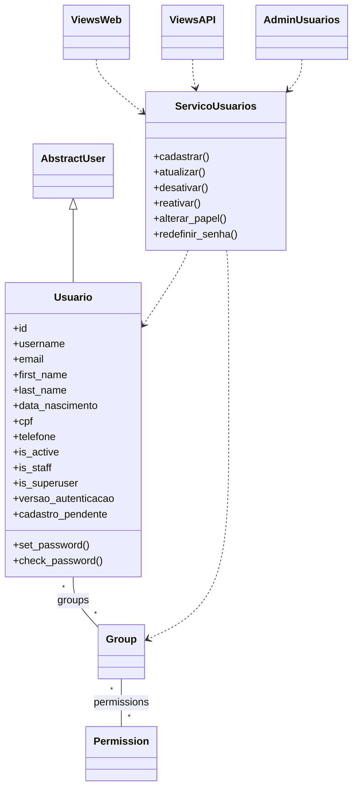
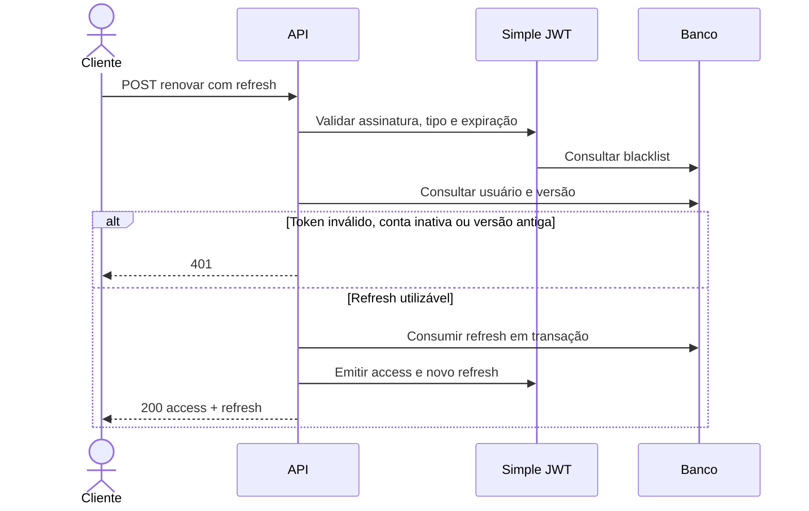
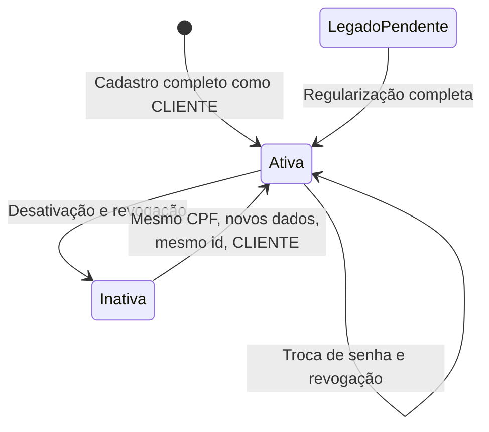

# App `usuarios`: cadastro, permissões e autenticação

## 1. Decisões e arquitetura

Criar `Usuario(AbstractUser)`, aproveitando autenticação, sessões, grupos, permissões, validadores de senha, formulários e Django Admin. Separar views HTML, API e regras compartilhadas em classes de serviço.

Decisões confirmadas:

- API usa JWT sem sessão, **consultando o usuário em cada acesso e renovação**, para garantir revogação imediata.
- Recuperação de senha envia **link para escolher uma nova senha**, substituindo o pedido inicial de envio de senha.
- Reativação pública exige somente CPF, preserva o `id`, substitui os dados cadastrais e atribui CLIENTE.
- CPF é imutável após cadastro; email é exclusivo sem distinguir maiúsculas; username mantém as regras nativas.
- Preservar banco, usuários, hashes, produtos e referências existentes.
- Implementar escrita de produtos na API.
- HTTP 401 para falha de autenticação; 403 para falta de permissão; 400 para validação; 404 para recurso inexistente.

**Consequência aceita:** conhecer o CPF de uma conta desativada será suficiente para assumir essa conta e seu histórico vinculado ao mesmo `id`.

O backend estritamente stateless do Simple JWT não atende à consulta de estado exigida; usar `JWTAuthentication` com validações adicionais. [Documentação oficial](https://django-rest-framework-simplejwt.readthedocs.io/en/stable/stateless_user_authentication.html)

## 2. Modelo, validações e autorização

### Modelo de usuário

Preservar os nomes e interfaces nativos: `id`, `username`, `email`, `password`, `first_name`, `last_name`, `is_active`, `is_staff`, `is_superuser`, `groups`, `user_permissions`, `last_login`, `date_joined`, `create_user()` e `create_superuser()`.

Adicionar:

| Campo | Regra |
|---|---|
| `data_nascimento` | Data ISO `AAAA-MM-DD`; idade mínima de 18 anos |
| `cpf` | String com 11 dígitos, validadores de dígitos verificadores e unicidade |
| `telefone` | String normalizada para dígitos, com DDD brasileiro |
| `versao_autenticacao` | Contador interno para invalidar sessões e tokens |
| `cadastro_pendente` | Exceção controlada para usuários legados incompletos |

Regras:

- Todos os dados cadastrais são obrigatórios em novos cadastros, inclusive administrativos e `createsuperuser`.
- Senha opcional na atualização; quando enviada, não pode ser vazia e passa pelos validadores Django considerando os dados finais do usuário.
- Usar `set_password()`; nunca devolver senha ou hash, inclusive em JWT, erros e telas administrativas.
- CPF aceita pontuação de apresentação, mas é armazenado apenas com dígitos; rejeitar sequências repetidas.
- Telefone aceita fixo de 10 ou celular de 11 dígitos com DDD válido; aceitar prefixo `+55` e removê-lo. Rejeitar ramais e números estrangeiros.
- Calcular idade por calendário usando a data local de `America/Bahia`; aniversários de 29/02 completam idade em 01/03 nos anos não bissextos.
- Username, email e CPF continuam reservados durante a desativação. Telefone não é exclusivo.
- Mensagens de validação em pt-BR; constraints no banco para unicidade.

### Papéis e permissões

Usar grupos Django `VENDEDOR` e `CLIENTE`; ADMIN é identificado por `is_superuser=True`, obrigatoriamente com `is_staff=True`. Expor `papel` como representação controlada, sem duplicar a autoridade em um campo independente.

| Ação | Visitante | CLIENTE | VENDEDOR | ADMIN |
|---|---:|---:|---:|---:|
| Consultar páginas de produtos | Sim | Sim | Sim | Sim |
| Consultar API de produtos | Não | Sim | Sim | Sim |
| Criar, alterar e excluir produtos pela API | Não | Não | Sim | Sim |
| Cadastrar CLIENTE | Sim | Sim | Sim | Sim |
| Consultar, editar e desativar a própria conta | Não | Sim | Sim | Sim |
| Listar e administrar qualquer usuário | Não | Não | Não | Sim |
| Promover ou rebaixar usuários | Não | Não | Não | Sim |
| Acessar Django Admin | Não | Não | Não | Sim |

- Associar permissões nativas `add`, `change`, `delete` e `view` de produtos aos grupos correspondentes.
- Aplicar autorização por objeto nos usuários; permissões nativas de modelo, isoladamente, não restringem ao próprio registro.
- Rejeitar com 403 tentativas de enviar campos privilegiados: `is_staff`, `is_superuser`, `is_active`, `groups`, `user_permissions`, `papel` e controles internos.
- Mesmo ADMIN altera papel e ativação por operações específicas; a edição cadastral comum não aceita esses campos.
- Impedir desativação e rebaixamento do último ADMIN ativo em API, Web e Django Admin.
- Serializar operações administrativas concorrentes em transação, com mecanismo compatível com SQLite; não depender somente de `select_for_update()`.
- Desabilitar exclusão física e ações administrativas em lote que contornem os serviços.

### UML de classes

## 3. Interfaces e fluxos

### API

Prefixo `/api/v1/usuarios/`:

| Método e rota relativa | Comportamento |
|---|---|
| `POST cadastrar/` | Cadastro público ou reativação; sempre CLIENTE |
| `POST login/` | Recebe `username` e `password`; retorna `access` e `refresh` |
| `POST renovar/` | Recebe `refresh`; retorna novo par |
| `POST redefinir_senha/` | Recebe email e solicita envio do link |
| `POST confirmar_senha/` | Recebe `uid`, `token` e `password`; efetiva a troca |
| `GET/PATCH/DELETE minha_conta/` | Consulta, atualização e desativação própria |
| `GET/POST /` | ADMIN lista ou cadastra usuários |
| `GET/PUT/PATCH/DELETE <id>/` | Próprio usuário ou ADMIN |
| `POST <id>/alterar_papel/` | ADMIN define ADMIN, VENDEDOR ou CLIENTE |
| `POST <id>/reativar/` | ADMIN reativa com cadastro completo |

- Cadastro administrativo também começa como CLIENTE; promoção ocorre separadamente.
- Listagem administrativa inclui inativos, ordenada por `id`, com paginação de 12 registros.
- `PUT` exige todos os campos cadastrais editáveis; `PATCH` aceita atualização parcial; senha permanece opcional em ambos.
- Cadastro novo retorna 201; reativação retorna 200; desativação retorna 204.
- Liberar explicitamente cadastro, login, renovação e as duas operações de recuperação de senha.
- Definir JWT e `IsAuthenticated` como padrão global da API.
- Produtos: preservar consultas e filtros; adicionar `POST` à coleção e `PUT/PATCH/DELETE` ao detalhe. Escrita exige ADMIN ou VENDEDOR.

### Web e navegação

Reutilizar `LoginView`, `LogoutView`, formulários de autenticação e componentes de recuperação de senha, adaptando validações e serviços.

- Visitante: **Produtos · Entrar · Cadastrar**.
- Autenticado: **Produtos · Minha conta · Sair**.
- ADMIN: adicionar **Usuários**.
- Disponibilizar cadastro, edição e desativação própria; para ADMIN, listagem, cadastro, edição, promoção, rebaixamento e reativação.
- Preservar identidade rosa e layout responsivo.
- Login, logout, cadastro, alteração, confirmação de senha e desativação usam POST com CSRF.
- GET apenas apresenta páginas e formulários; abrir o link de recuperação não altera a senha.
- Logout encerra somente a sessão Web atual.

### JWT, sessões e recuperação

- `Authorization: Bearer <access>`.
- Access: 30 minutos. Refresh: 24 horas a partir da emissão, inclusive após rotação.
- Ativar rotação, blacklist dos refresh utilizados e migrações de `token_blacklist`.
- Incluir no JWT apenas identificadores técnicos necessários, incluindo `user_id` e `versao_autenticacao`; não incluir dados cadastrais, permissões congeladas ou hashes.
- Em cada acesso, consultar `is_active`, versão e permissões atuais.
- Na renovação, verificar assinatura, expiração, tipo, blacklist, usuário ativo e versão; consumir o refresh atomicamente para impedir duas renovações concorrentes.
- Troca/redefinição de senha, desativação, reativação e mudança de papel incrementam a versão e revogam refresh anteriores.
- Registrar a versão na sessão Web e verificá-la nas requisições. Após troca de senha, exigir novo login, inclusive na sessão atual.
- Não depender de `CHECK_REVOKE_TOKEN`, que introduz um derivado do hash da senha no token; usar o contador próprio.
- Recuperação usa tokens temporários do Django, com validade de uma hora e resposta genérica para emails inexistentes ou contas inativas. Falha no envio não altera a senha.
- Desenvolvimento usa console; testes usam backend de memória; produção configura envio real por variáveis de ambiente.
- Programar limpeza diária de tokens expirados com `flushexpiredtokens`.

### Reativação e legado

- Validar integralmente os novos dados antes de modificar a conta.
- CPF ativo duplicado retorna 400.
- CPF inativo existente reativa o mesmo registro, substitui cadastro e senha, remove privilégios e associa CLIENTE.
- Colisão de username/email com outra conta retorna 400 sem atualização parcial.
- Na reativação administrativa, também começar como CLIENTE; eventual promoção é explícita.
- Usuários legados incompletos podem autenticar, mas ficam limitados à própria consulta, regularização, desativação, logout e recuperação de senha. As páginas públicas continuam acessíveis.
- CPF ausente no legado pode ser preenchido uma vez; após isso torna-se imutável.

### UML de renovação

## 4. Compatibilidade e migração

A compatibilidade do Simple JWT com Python 3.14, Django 6.1.2 e DRF 3.18.3 **não está confirmada** pela matriz publicada consultada. Não alterar as versões atuais para acomodá-lo automaticamente. [Requisitos oficiais](https://django-rest-framework-simplejwt.readthedocs.io/en/stable/getting_started.html)

Implementar em etapas:

1. **Validar dependência:** verificar metadados e resolução sem instalação no ambiente principal; testar a versão candidata em ambiente isolado com as versões fixadas. Exigir imports, migrações, emissão, autenticação, renovação e blacklist funcionando antes de adicioná-la às dependências. Se falhar, interromper essa etapa e apresentar o conflito.
2. **Preparar migração conservadora:** manter a tabela física de usuários existente e mapear explicitamente tabelas/colunas das relações de grupos e permissões. Introduzir `Usuario` na migração inicial de `usuarios`, com transição de estado e banco em etapas antes da troca definitiva de `AUTH_USER_MODEL`.
3. **Preservar histórico:** preparar a migração inicial ainda com a configuração antiga, evitando que migrações administrativas já aplicadas passem a depender de uma migração ausente. Não apagar banco, reescrever migrações antigas ou usar `--fake` indiscriminadamente.
4. **Migrar dados:** preservar PKs, hashes, grupos, permissões e referências administrativas; manter superusuários como ADMIN e mapear demais usuários para CLIENTE por padrão. Marcar cadastros incompletos como pendentes.
5. **Aplicar constraints:** identificar emails duplicados antes da unicidade; não mesclar contas nem inventar dados. Havendo conflitos, interromper a migração com diagnóstico para correção.
6. **Entregar funcionalidades:** serviços e validadores → autenticação → API de usuários → CRUD de produtos → Web/Admin.
7. **Atualizar documentação:** incluir `usuarios/`, regras confirmadas, comandos e nova política de acesso no AGENTS.md; incluir `usuarios/tests` na descoberta do pytest.

A troca de usuário após migrações exige tratamento explícito de esquema e dados, conforme a orientação do Django. Ensaiar a transição em banco de teste representando o esquema antigo e validar também instalação limpa. [Documentação de usuário customizado](https://docs.djangoproject.com/en/6.0/topics/auth/customizing/#changing-to-a-custom-user-model-mid-project)

**Limite desta análise:** o banco e arquivos ignorados não foram consultados. A execução sobre dados reais depende de acesso autorizado ao banco, backup e ensaio da migração; o plano não autoriza descartar dados.

## 5. Testes e critérios de aceite

Usar pytest, pytest-django, `APIClient` e Faker `pt_BR`, com fixtures determinísticas nos casos de fronteira.

- **Cadastro:** obrigatoriedade, CPF, telefone, email exclusivo, aniversário de 18 anos, datas inválidas e validação de senha.
- **Autorização:** matriz completa de papéis; acesso a usuário alheio retorna 403; campos privilegiados são rejeitados.
- **Admin:** flags coerentes, permissões sincronizadas e proteção do último ADMIN, inclusive sob concorrência.
- **Reativação:** mesmo `id`, novos dados, CLIENTE, colisões sem alterações parciais e tokens antigos permanentemente inválidos.
- **JWT:** expiração, rotação, replay, blacklist, concorrência, conta desativada e troca de senha bloqueando acesso e renovação.
- **Web:** CSRF, logout POST, navegação por papel, sessão revogada e ausência de mutações por GET.
- **Recuperação:** email enviado com link, token expirado/reutilizado rejeitado, senha alterada somente na confirmação e nenhuma senha/hash nas respostas.
- **Legado/migrações:** preservação de dados e relações, regularização obrigatória, instalação limpa e migração do esquema antigo.
- **Produtos:** páginas continuam públicas; API exige JWT; escrita respeita papéis e mantém validações atuais.

Executar pela `.venv`: testes completos, `manage.py check`, verificação de migrações pendentes, Ruff e verificadores de tipos disponíveis no projeto. A entrega só está pronta com regressões existentes passando e os novos fluxos cobertos.
